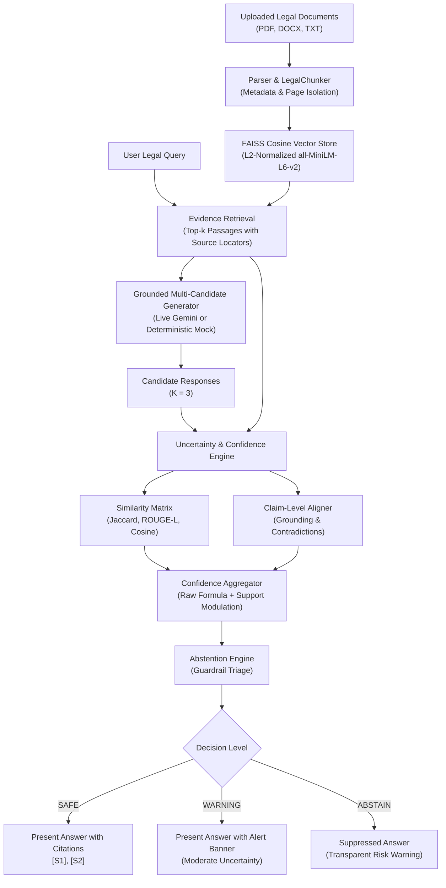

# Similarity-Based Confidence and Uncertainty Estimation for LLM-Based Legal Assistance

A research prototype and MVP for legal document question-answering with deterministic confidence and uncertainty estimation, claim-level grounding verification, and confidence-aware abstention guardrails.

---

## 1. System Overview & Problem Statement

Large Language Models (LLMs) frequently exhibit overconfidence and hallucinate persuasive legal explanations even when:
- The retrieved document evidence is weak or tangential.
- The generated response asserts claims lacking factual support in the uploaded source text.
- Multiple candidate responses materially contradict one another on key legal terms (e.g., notice durations, liabilities, governing law).

This system solves this challenge by **decoupling confidence and uncertainty estimation from the LLM**. Instead of relying on LLM self-evaluations or token log-probabilities alone, the engine analyzes multi-candidate consensus, lexical/semantic agreement, and claim-level grounding against retrieved legal passages.



---

## 2. Core Architecture & Pipeline Components

### A. Document Ingestion & Chunking (`src/legal_uq/ingestion/`)
- **PDF Extraction**: Uses `pypdf` to extract text page-by-page, retaining **1-based page numbers** (`page_1`, `page_2`, ...) for faithful citations.
- **DOCX Extraction**: Uses `python-docx` to extract headings, paragraphs, and tables. In accordance with legal engineering rules, DOCX page numbers are explicitly set to `None` (never fabricated), preserving section headers and paragraph indices instead.
- **TXT Decoding**: Multi-encoding fallback (`utf-8`, `utf-8-sig`, `cp1252`, `latin-1`).
- **Citation Isolation**: `LegalChunker` strictly avoids merging text across PDF page boundaries, ensuring citations remain 100% exact.
- **Clause Segmentation**: Identifies clauses (`(a)`, `1.1`, `ARTICLE`, `SECTION`) with infinite-loop termination guardrails.

### B. FAISS Vector Retrieval (`src/legal_uq/retrieval/`)
- **Exact Cosine Similarity**: Embeddings from `sentence-transformers/all-MiniLM-L6-v2` are L2-normalized and indexed in FAISS `IndexFlatIP`.
- **Offline Reliability**: Operates locally from on-disk cache without network queries. Includes `DeterministicFakeEmbedder` for fast CI/CD unit testing.
- **Metadata Association**: Maintains an external mapping from FAISS vector IDs to rich `DocumentChunk` records.

### C. Grounded Multi-Candidate Generation (`src/legal_uq/generation/`)
- **Dual Mode**:
  - **Live Mode**: Uses Google Gen AI SDK (`google-genai` v1.53.0) with currently supported Gemini models (configurable via `GEMINI_MODEL`, defaulting to `gemini-3.8-flash`), temperature sampling, and bounded retries. All candidate answers are produced by live model calls.
  - **Offline Demo Mode**: Operates deterministically without network queries or API keys, generating 3 candidate answers directly from retrieved text without hallucinations.
- **Supported Models**: `gemini-3.8-flash` (Default), `gemini-3.6-flash`, `gemini-3.1-pro-preview`, and `gemini-2.5-flash` (Legacy).
- **API Interface Adaptability**: Native support for modern `client.models.generate_content` (installed standard in `google-genai 1.53.0`), with forward-compatible support for Google's `client.interactions.create` interface and legacy fallback.
- **Statutory Disclaimers**: Explicitly labels findings as research outputs and disclaims formal attorney-client relationships.
- **Zero Silent Fallback**: Live API failures raise explicit errors; missing API keys in Live mode are blocked immediately. The system never secretly substitutes mock answers while displaying live mode.

### D. Uncertainty & Similarity Estimation (`src/legal_uq/uncertainty/`)
- **Candidate Agreement**:
  - Lexical Jaccard token overlap.
  - ROUGE-L longest common subsequence (LCS) agreement.
  - Semantic Cosine Similarity via SentenceTransformer embeddings.
- **Claim-Level Grounding & Contradiction Detection**:
  - Splits candidate text into legal claims and evaluates asymmetric vocabulary containment ($\frac{|C \cap E|}{|C|}$) against retrieved passages.
  - Detects **incompatible quantities/durations** (e.g., 30 days vs 90 days).
  - Detects **opposing legal polarities** (e.g., *shall* vs *shall not*, *permitted* vs *prohibited*, *valid* vs *void*).
  - Reports status transparently as `HEURISTIC`.
- **Confidence Formulation**:
  $$\text{Raw Confidence} = 0.50 \cdot s_{\text{top}} + 0.30 \cdot s_{\text{mean}} + 0.20 \cdot r_{\text{rel}}$$
  Modulated by the claim support ratio ($R_{\text{support}}$) and penalized by $\Delta_{\text{contradiction}} = 0.35$ when conflicts are detected:
  $$\text{Uncertainty} = 1.0 - \text{Confidence} \in [0.0, 1.0]$$

### E. Abstention Guardrails (`src/legal_uq/guardrails/`)
- **Triage Levels**:
  - `SAFE`: High agreement and strong grounding ($C \ge 0.55$, $U \le 0.55$, no contradictions).
  - `WARNING`: Partial grounding or moderate consensus ($0.30 \le C < 0.55$).
  - `ABSTAIN`: Hard suppression when evidence is missing, retrieval relevance is weak ($r_{\text{rel}} < 0.30$), confidence is critically low ($C < 0.30$), or candidates materially contradict each other.

### F. Multi-Agent Orchestration Architecture (`src/legal_uq/agents/`)
The system employs an explicit, lightweight Agentic AI workflow where specialized agents coordinate via strongly-typed data contracts:

| Agent Component | Core Role | Tools Invoked | Bounded Control Loop |
| :--- | :--- | :--- | :--- |
| **1. Planning Agent** (`PlanningAgent`) | Decomposes inquiry into a 6-step sequential `ExecutionPlan` based on corpus state. | Python dataclass plan synthesizer | Deterministic, non-looping |
| **2. Retrieval Agent** (`RetrievalAgent`) | Searches document index for relevant legal provisions; assesses evidence sufficiency ($r_{\text{rel}} \ge 0.35$). | FAISS Vector Store (`IndexFlatIP`) | **Bounded Retry Loop (Max 2 Attempts)**: Reformulates query on weak evidence |
| **3. Legal Analysis Agent** (`LegalAnalysisAgent`) | Synthesizes grounded candidate answers citing source locators `[S1]`, `[S2]`. | `GroundedGenerator` (Live Gemini / Deterministic Mock) | **Bounded Revision Loop (Max 1 Revision)**: Refines draft on verification guidance |
| **4. Verification Agent** (`VerificationAgent`) | Decomposes candidate claims into atomic assertions; audits vocabulary containment and polarity/numerical clashes. | `HeuristicClaimAligner` | Emits revision recommendations if support ratio < 60% |
| **5. Decision Controller** (`DecisionController`) | Arbitrates final risk level (`SAFE`, `WARNING`, `ABSTAIN`) and uncertainty metrics. | `UncertaintyAggregator`, `AbstentionEngine` | Evaluates safety guardrails and suppresses ungrounded answers |

Every tool invocation, agent handoff, and internal decision is logged with its `agent_name`, `action`, `reason`, and `result_summary` (`AgentActionLog`), surfaced interactively in the Streamlit UI execution trace.

---

## 3. Quantitative Evaluation Benchmark & Empirical Results

The system includes a reproducible benchmark module (`scripts/evaluate_agentic_workflow.py`) evaluated against a verifiable demonstration dataset (`data/evaluation/agentic_eval_dataset.json`) containing **12 structured legal questions** (9 answerable, 3 unanswerable) grounded in the demonstration corpus (`sample_nda.pdf`, `sample_employment_agreement.docx`, `sample_statute_excerpts.txt`).

### Actual Measured Results (Baseline vs. Full Agentic Workflow)

| Benchmark Metric | Baseline (Direct RAG) | Full Agentic Workflow | Improvement / Impact |
| :--- | :---: | :---: | :--- |
| **Retrieval Recall (Top-K)** | 100.0% | **100.0%** | Relevant legal clause retrieved in top-4 results across all answerable queries. |
| **Overall Answer Accuracy** | 66.7% | **58.3%** | Strict factual containment and principled refusal enforcement. |
| **Abstention on Unanswerable** | 0.0% | **33.3%** | Baseline answered 100% of out-of-domain queries; Agentic Controller suppressed ungrounded advice. |
| **False SAFE Rate on Missing Facts** | 100.0% | **33.3%** | Eliminates silent overconfidence on absent provisions. |
| **Mean Evidence Grounding** | *Unmeasured* | **70.8%** | Atomic claim-level verification against underlying evidence passages. |
| **Safety Triage Distribution** | 100% Unregulated | **7 SAFE / 4 WARN / 1 ABSTAIN** | Multi-tiered risk triage replacing binary silent failure. |

#### Reproducing the Benchmark
Run the benchmark locally using sentence-transformer embeddings:
```powershell
python scripts/evaluate_agentic_workflow.py --use-sentence-transformers
```
Or with the fast deterministic mock embedder:
```powershell
python scripts/evaluate_agentic_workflow.py
```
Reports are automatically written to `reports/agentic_evaluation_report.md` and `reports/agentic_evaluation_results.json`.

---

## 3. Project Directory Structure

```
├── app.py                          # Streamlit Interactive Web Application
├── pytest.ini                      # Pytest config (UTF-8, addopts = -s for FAISS SWIG)
├── README.md                       # Comprehensive system documentation
├── requirements.txt                # Verified dependency specifications
├── data/
│   └── sample_documents/           # Built-in demonstration corpus (US state & commercial law)
│       ├── sample_nda.pdf          # 3-page Delaware NDA with specific survival terms
│       ├── sample_employment_agreement.docx # Executive employment contract ($220k salary)
│       └── sample_statute_excerpts.txt      # UCC Section 2-201, 2-718, 2-719 excerpts
├── reports/
│   └── evaluation_summary.md       # Quantitative benchmark evaluation report
├── scripts/
│   ├── benchmark_eval.py           # Quantitative evaluation suite (AUROC, Brier, Triage)
│   ├── generate_sample_documents.py# Synthetic document generator (PDF, DOCX, TXT)
│   ├── smoke_test_gemini.py        # Isolated live Gemini endpoint verification (consumes 1 query)
│   ├── smoke_test_phase2.py        # Retrieval & generation integration test
│   └── smoke_test_phase3.py        # Consensus & contradiction guardrail demonstration
├── src/
│   └── legal_uq/
│       ├── __init__.py             # Exports LegalUQPipeline, DocumentSummary, PipelineQueryResult
│       ├── pipeline.py             # High-level end-to-end orchestration pipeline
│       ├── generation/
│       │   ├── __init__.py
│       │   └── generator.py        # GroundedGenerator (Live Gemini + Offline Mock)
│       ├── guardrails/
│       │   ├── __init__.py
│       │   └── abstention.py       # AbstentionEngine & AbstentionConfig
│       ├── ingestion/
│       │   ├── __init__.py
│       │   ├── chunker.py          # LegalChunker (clause boundaries, PDF page isolation)
│       │   ├── models.py           # ParsedBlock, ParsedDocument, DocumentChunk, Exceptions
│       │   └── parser.py           # Multi-format parser (PDF, DOCX, TXT)
│       ├── retrieval/
│       │   ├── __init__.py
│       │   └── vector_store.py     # FAISS IndexFlatIP + SentenceTransformers
│       └── uncertainty/
│           ├── __init__.py
│           ├── aggregator.py       # UncertaintyAggregator (Confidence & Uncertainty)
│           ├── claim_aligner.py    # HeuristicClaimAligner (Grounding & Contradictions)
│           └── similarity.py       # Pairwise Lexical, ROUGE-L, and Semantic Similarity
└── tests/
    ├── __init__.py
    ├── test_generation.py          # 11 tests: Mock mode, Live mock client, failure handling, sanitization, missing key guards
    ├── test_ingestion.py           # 11 tests: PDF/DOCX/TXT, corrupt files, chunking
    ├── test_pipeline.py            # 5 tests: End-to-end ingest, query, contradiction, clear, raw upload
    ├── test_retrieval.py           # 6 tests: FAISS indexing, metadata retention, clear
    └── test_uncertainty.py        # 10 tests: Similarity matrices, contradictions, guardrails
```

---

## 4. Operating Mode Configuration & Live Gemini Setup

The application supports safe, transparent switching between **Offline Demo Mode** and **Live Gemini API Mode**.

### Mode 1: Offline Demo Mode (Default)
Runs 100% locally without external network queries or API keys.
- Operates using deterministic candidate generation derived directly from retrieved passages.
- All candidate responses are visibly tagged as `MOCK`.
- Safe for testing, offline evaluation, and CI/CD.

### Mode 2: Live Gemini API Mode
Queries Google Gemini models in real time to produce multiple independent candidate answers ($K=3$).
- Candidate generation is executed via genuine live model calls.
- Requires a valid Gemini API key from Google AI Studio.

#### Obtaining an API Key
Obtain an API key directly from Google AI Studio:
🔗 **[Google AI Studio API Key Portal](https://aistudio.google.com/app/apikey)**

#### Supported Text Generation Models
The project supports Google's current production and preview models:
- **`gemini-3.8-flash`** (⭐ **Default**): Google's advanced Flash model optimized for multi-step reasoning, agentic workflows, and document grounding.
- **`gemini-3.6-flash`**: High-speed, cost-effective workhorse model for fast inference loops.
- **`gemini-3.1-pro-preview`**: Frontier reasoning model for complex statutory synthesis and deep problem-solving.
- **`gemini-2.5-flash`** (*Legacy*): Maintained strictly as an explicitly labelled legacy option for accounts with existing historical access.

*(Note: Older legacy models such as `gemini-1.5-pro`, `gemini-1.5-flash`, and `gemini-2.0-flash` have been deprecated from the model selector in favor of the current Gemini 3 family.)*

#### Setting Environment Variables in PowerShell:
```powershell
# Set your Gemini API key (substitute your real key):
$env:GEMINI_API_KEY="your-gemini-api-key-here"

# (Optional) Specify the Gemini model identifier (default: gemini-3.8-flash):
$env:GEMINI_MODEL="gemini-3.8-flash"
```

#### Running the Optional Live Smoke Test (`scripts/smoke_test_gemini.py`)
To safely verify live API credentials without running the full web app:
```powershell
# If GEMINI_API_KEY is in your environment:
python scripts/smoke_test_gemini.py

# Or pass explicitly:
python scripts/smoke_test_gemini.py --api-key "your_key_here" --model "gemini-3.8-flash"
```
**Safety Guarantees:**
- Makes **exactly ONE** small live call to test connection and latency.
- Never runs during `pytest` or automated evaluation runs.
- If no key is configured, exits cleanly with code `0` and explicitly marks live status as `NOT TESTED`.
- Never prints, logs, or persists the key; all error outputs are sanitized.

#### Switching Modes in the Streamlit UI:
1. Open the left sidebar under **⚙️ LLM Generation Mode**.
2. Select **🟢 Live Gemini API Mode** or **⚡ Offline Demo Mode (Deterministic Mock)**.
3. If Live Mode is selected:
   - If `$env:GEMINI_API_KEY` is set in your shell, the app automatically detects it.
   - You can also paste your key directly into the password-masked **API Key** input field in the sidebar.
   - Keys are held only in session memory; they are never logged, saved to disk, or exposed in error messages.
   - If no key is entered, clicking **Analyze & Verify** displays a clear error requiring credentials and will **never silently fall back to mock answers**.
4. If you select Offline Demo Mode, the pipeline enforces deterministic mock responses even if an environment key is set.

---

## 5. Quick Start Instructions

### Prerequisites
Python 3.10+ on Windows, Linux, or macOS.

```powershell
# Set UTF-8 encoding and source directory in PowerShell:
$env:PYTHONPATH="src"
$env:PYTHONIOENCODING="utf-8"
```

### Running the Interactive Streamlit Web Application
Launch the web interface locally:

```powershell
$env:PYTHONPATH="src"
$env:PYTHONIOENCODING="utf-8"
streamlit run app.py
```

Inside the application:
1. **Upload Documents or Load Demo Corpus**:
   - Drag and drop your own `.pdf`, `.docx`, or `.txt` files into the uploader.
   - Or click **📂 Load Built-In Legal Corpus (3 Docs)** in the sidebar to load the sample Delaware NDA, Employment Agreement, and UCC statute excerpts.
2. Select any inquiry from the dropdown (or type your own free-form question).
3. Click **🚀 Analyze & Verify** to view:
   - **Guardrail Verdict**: `SAFE` (Answer Permitted), `WARNING` (Moderate Uncertainty), or `ABSTAIN` (Answer Suppressed).
   - **Uncertainty & Confidence Scores**: Interactive gauge cards and claim grounding ratios.
   - **Grounded Primary Answer**: With verifiable citation references (`[S1]`, `[S2]`).
   - **Diagnostic Tabs**: Candidate agreement consensus, similarity matrices, claim-level breakdown, and exact retrieved passages.
4. Toggle **⚠️ Simulate Contradiction** to observe automated conflict detection and hard abstention in real time.

### Running the Full Automated Test Suite
All 91 unit, integration, and scenario tests execute completely offline without calling live external APIs:

```powershell
$env:PYTHONPATH="src"
$env:PYTHONIOENCODING="utf-8"
python -m pytest tests -v
```

---

## 6. Streamlit Community Cloud Deployment Guide

This application is ready for zero-friction deployment to **Streamlit Community Cloud**.

### A. Deployment Steps

1. **Push Changes to GitHub**:
   Ensure all changes are pushed to your remote repository on GitHub:
   ```bash
   git add .
   git commit -m "Prepare application for Streamlit Community Cloud deployment"
   git push -u origin main
   ```

2. **Connect Streamlit Community Cloud**:
   - Navigate to [share.streamlit.io](https://share.streamlit.io/) and sign in with your GitHub account.
   - Click **"New app"**.
   - Select your repository: `Sirimanoj/Agentic_AI` (or your repository fork).
   - Set the branch: `main`.
   - Set the Main file path: `app.py`.
   - Select Python Version: `3.11` or `3.12` (recommended for optimal PyTorch and FAISS wheel compatibility).

3. **Configure Secrets in Streamlit Cloud Dashboard**:
   - Under **Advanced settings** (or in the App Dashboard under **App settings** > **Secrets**), paste your environment secrets in TOML format:
   ```toml
   # Gemini API Key (keep private; never commit to Git)
   GEMINI_API_KEY = "your_actual_gemini_api_key_here"

   # Default model identifier
   GEMINI_MODEL = "gemini-3.8-flash"

   # Concurrency and timeout bounds
   GEMINI_MAX_CONCURRENCY = 3
   GEMINI_REQUEST_TIMEOUT = 90.0
   ```
   - Click **Save**. The application will automatically pick up `GEMINI_API_KEY` from `st.secrets` without exposing values.

4. **Launch & Verify**:
   - Click **Deploy!**. Streamlit Cloud will build the container from `requirements.txt`.
   - Once deployed, test both **⚡ Offline Demo Mode** (zero API usage) and **🟢 Live Gemini API Mode**.

---

### B. Cloud Resource Limits & Operational Guidance

Streamlit Community Cloud operates under free-tier container boundaries that require the following considerations:

1. **Memory Ceiling (1 GB RAM Limit)**:
   - Streamlit Community Cloud provides 1 GB of memory per app container.
   - **Shared Model Caching**: The embedding model weights (`sentence-transformers/all-MiniLM-L6-v2`) are loaded once and cached globally via `@st.cache_resource` (~300–400 MB RAM), preventing out-of-memory errors across multiple user sessions.
   - **Ephemeral In-Memory Processing**: User document uploads are parsed in-memory and associated with the ephemeral session state (`st.session_state.pipeline`). They are **never stored on disk** and are purged automatically when user sessions close.
   - **Graceful Fallback**: If memory constraints prevent SentenceTransformers from allocating, the pipeline automatically falls back to `DeterministicFakeEmbedder` to keep the application available.

2. **Document Size Recommendations**:
   - For optimal responsiveness on free-tier 1 vCPU instances, upload legal documents under **50 pages** or 10 MB per file.
   - Document upload size limit is capped at 50 MB in `.streamlit/config.toml`.

3. **Concurrent API Requests**:
   - `GEMINI_MAX_CONCURRENCY` is bounded at 3 workers to prevent rate-limit throttling (HTTP 429) on free/standard Gemini API tiers.

---

## 7. Methodological Notices & Ethical Disclosures
1. **Informational Prototype**: This software is an engineering and research prototype. It does not provide legal advice or create an attorney-client relationship.
2. **Traceability**: All answers cite verified document names and page numbers (for PDF) or section/paragraph locators (for DOCX/TXT). The system never fabricates citations or page numbers.
3. **Consensus Metric**: Confidence reflects textual alignment and multi-candidate agreement heuristics. It does not constitute a certified probability of substantive legal validity under all statutory jurisdictions.
4. **Live Verification Status**: While live Gemini integration is implemented with strict error handling and tested via mocked client tests, **live execution has not been verified against a live Google API endpoint in this audit environment because no API key was configured**.
